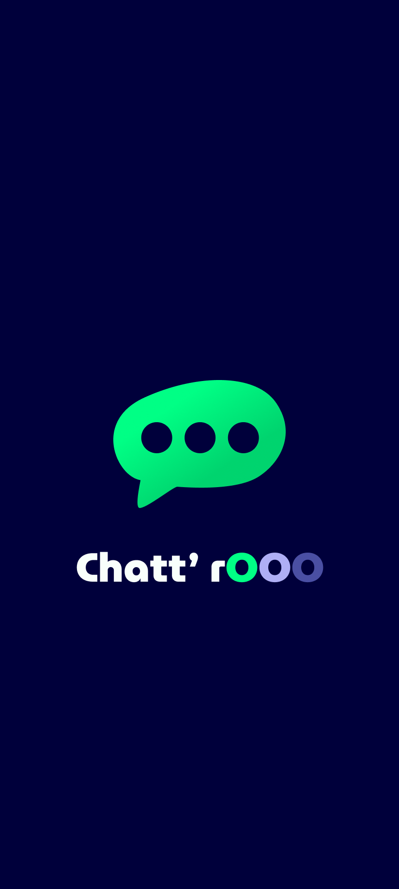
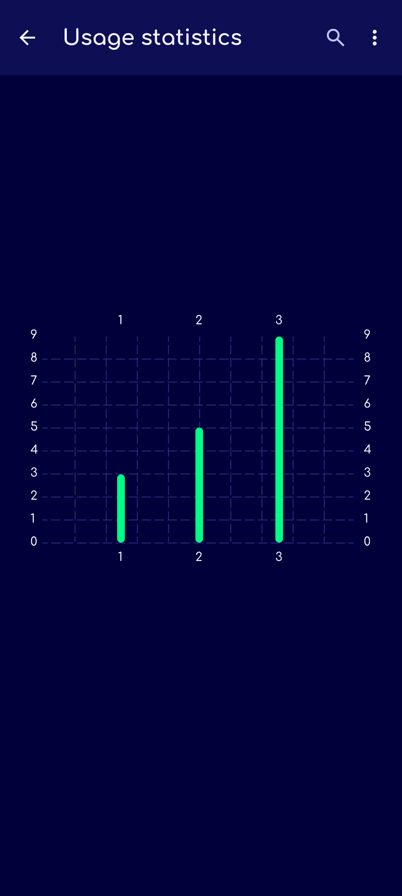
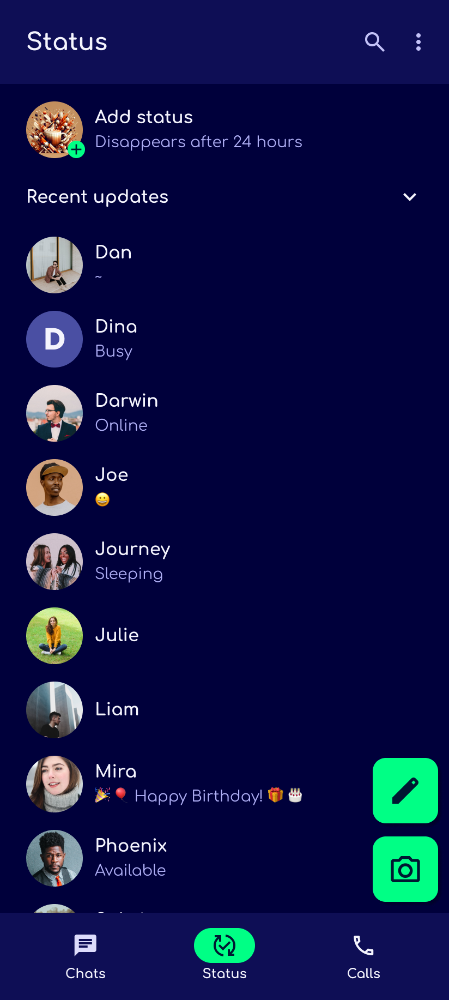
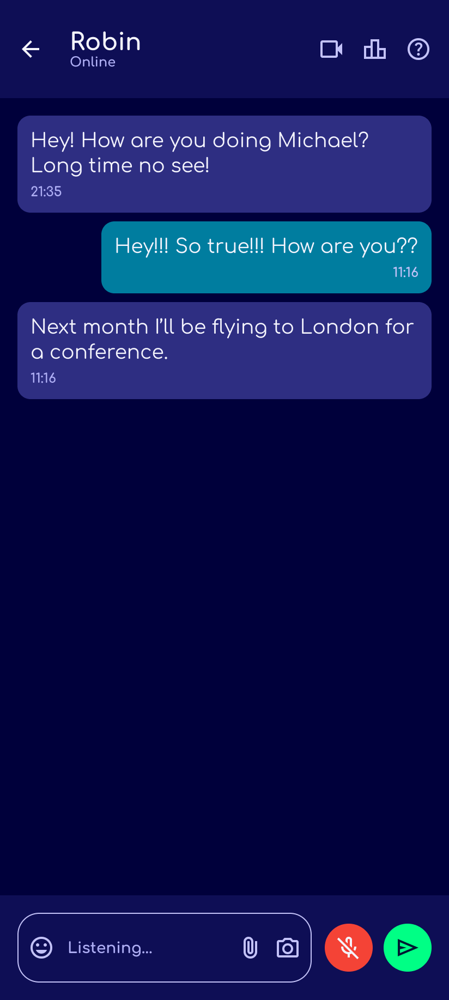
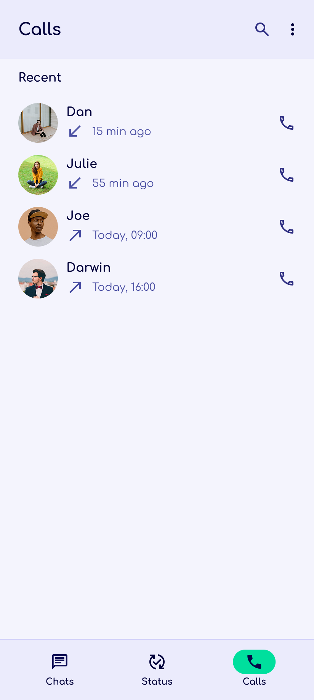
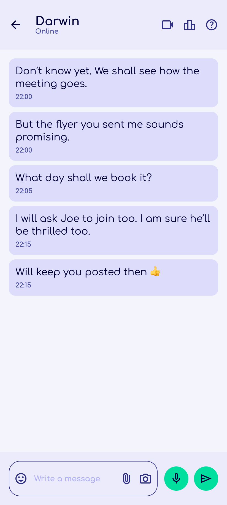
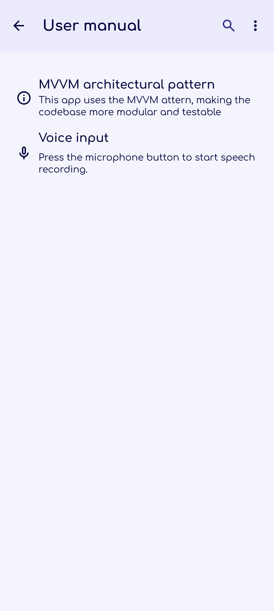

# 💬 Chatt'rOOO — Diseño UI/UX en Figma

 **[Probar prototipo en Figma — Modo Claro ☀️](https://www.figma.com/proto/HjM2mehhwxVb3ox7uWW2lk/Chatt-OOO-APP?node-id=77-57&p=f&t=fWZ32t8Wx4ozcbgr-0&scaling=scale-down&content-scaling=fixed&starting-point-node-id=136%3A1028&show-proto-sidebar=1)**  
 **[Probar prototipo en Figma — Modo Oscuro 🌙](https://www.figma.com/proto/HjM2mehhwxVb3ox7uWW2lk/Chatt-OOO-APP?node-id=77-57&p=f&t=fWZ32t8Wx4ozcbgr-0&scaling=scale-down&content-scaling=fixed&starting-point-node-id=90%3A2322&show-proto-sidebar=1)**

---

## Vistas Principales

  
  
  
  
  
  
  
  

---

## Concepto y Propuesta de Diseño

**Chatt'rOOO** plantea una interfaz de chat clara e intuitiva, diseñada en inglés, pensada como base para su desarrollo posterior en **Flutter**.

- **Temas claro y oscuro:** dos paletas completas que conservan el contraste y la lectura en ambas versiones.
- **Paso a Flutter:** diseño modular que facilita llevar las pantallas a código, donde se añade la interacción real (teclado, voz a texto y respuestas simuladas).
- **Elementos visuales:** *Splash Screen*, avatares circulares, burbujas de chat, botón de voz y vista con gráfico.

---

## Herramientas

- **Figma** (diseño de interfaz, sistema de color Light/Dark, componentes reutilizables y prototipado interactivo)
- **Sistema de iconografía y recursos gráficos** (icono de app adaptativo, Iconstack e interfaz conversacional)